# 1. Product Introduction

## 1.1 Product Safety

This product contains small parts. Keep it away from children.

Follow this tutorial strictly to avoid damaging the product, and pay attention to electrical safety.

## 1.2 Product Overview

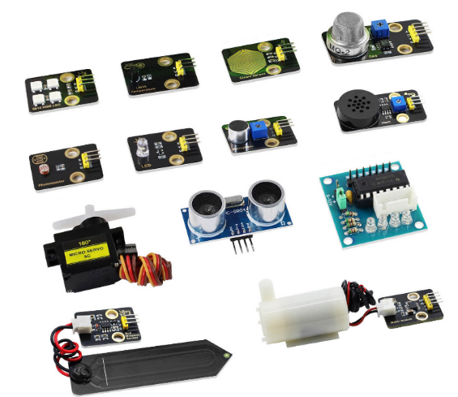

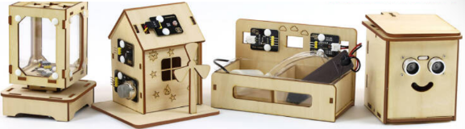

This tutorial covers the **KT0378 Sensor Expansion Pack** and the **KT0379 Wooden Model Expansion Pack**. Both are expansion components designed for the Xiaozhi AI Chat Robot series kits and work with the Xiaozhi AI Chat Robot main control board.

**KT0378 Sensor Expansion Pack**: includes 10 commonly used sensor and actuator modules. Working with the main control board, it enables functions such as sound, light, electricity, temperature, gas detection, distance measurement, and motion control. Each module uses a 2.54mm pin-header interface and connects easily with jumper wires — no soldering required. It is suitable for maker learning and AI application development.

**KT0379 Wooden Model Expansion Pack**: includes wooden model parts and matching electronic modules, used to build 4 model expansion projects: Rotating Color Light (Music Box), Environment Monitoring, Automatic Watering, and Smart Trash Bin. Each project is controlled by voice (wake word "你好小智") and programmed with KidsBlock graphical programming.

This tutorial contains 14 projects in total: Chapter 5 covers the 10 projects of the KT0378 Sensor Expansion Pack, and Chapter 6 covers the 4 model projects of the KT0379 Wooden Model Expansion Pack. Each project is an independent chapter, guiding users step by step from module introduction and wiring to code examples and running results. All code is based on the KidsBlock graphical programming environment — drag and drop blocks to write programs, suitable for teenagers and beginners.

## 1.3 Sensor Expansion Pack List (KT0378)

| Hardware Name | Main Purpose | Qty | Image |
| --- | --- | --- | --- |
| White LED Module | Digital output, lights up on high level | 1 | 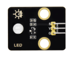 |
| 6812 RGB Module | Single-bus control, programmable full color | 1 |  |
| Water Pump Driver Module | Controls and drives the water pump | 1 |  |
| Photoresistor Sensor | Analog output, detects ambient light intensity | 1 |  |
| Sound Sensor | Analog output, detects sound intensity | 1 | 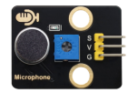 |
| Water Drop Sensor | Analog output, detects humidity / water drops | 1 |  |
| LM35 Temperature Sensor | Analog output, detects ambient temperature | 1 |  |
| MQ-2 Gas Sensor | Analog output, detects flammable gas and smoke | 1 | 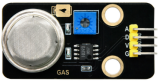 |
| 9G Servo | PWM control, 0~180° rotation | 1 | 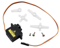 |
| HC-SR04 Ultrasonic Sensor | Distance measurement 3~400cm | 1 |  |
| 8002b Amplifier Speaker Module | Plays music | 1 |  |
| Capacitive Soil Moisture Sensor | Measures soil moisture | 1 |  |
| ULN2003 Motor Driver Board | Drives the stepper motor | 1 | 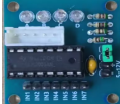 |
| 28BYJ-48 4-Phase 5-Wire Stepper Motor | DC:5V stepper motor | 1 | 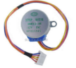 |
| Watering Pump | Silent mini submersible pump | 1 |  |
| Watering Hose | Connects the pump for water delivery | 1 |  |
| 3-Pin Jumper Wire | Connection between 3-pin modules and the board | 3 |  |
| 4-Pin Jumper Wire | Connection between 4-pin modules and the board | 2 |  |
| XH-2.54 to Jumper Wire (4P) | Dedicated adapter for the mobile version main board | 2 |  |
| XH-2.54 to Jumper Wire (3P) | Dedicated adapter for the mobile version main board | 3 | 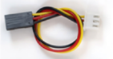 |
| Female-to-Female Jumper Wire | Connects the stepper motor driver board to the main board | 1 |  |

## 1.4 Wooden Model Expansion Pack List (KT0379)

> Note: the table below is compiled from the KT0379 kit sample confirmation sheet (V00).

| No. | Part Name | Qty | Image |
| --- | --- | --- | --- |
| 1 | Blister pack tray | 2 | 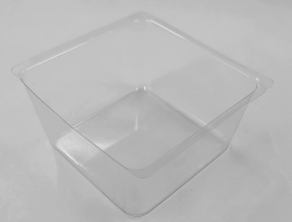 |
| 2 | Nylon rivet (R4060 press-fit) | 16 | 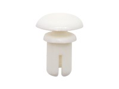 |
| 3 | Nylon rivet (R3090 press-fit) | 16 |  |
| 4 | Screw (M1.4*10MM round head cross) | 4 | 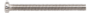 |
| 5 | Nut (M1.4, nickel-plated) | 4 |  |
| 6 | Nut (M2, nickel-plated) | 2 |  |
| 7 | Screw (M2*12MM round head cross) | 2 |  |
| 8 | Self-tapping screw (M1.2*4MM round head cross, self-tapping) | 4 | 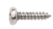 |
| 9 | Screw (M2*10MM round head cross) | 1 | 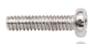 |
| 10 | Basswood board + Acrylic board | 1 | 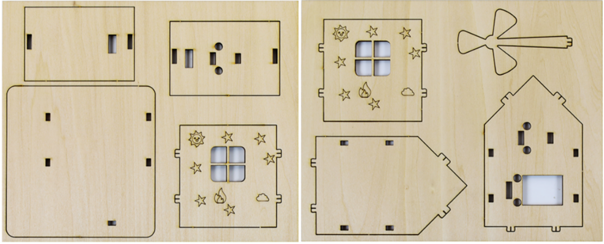  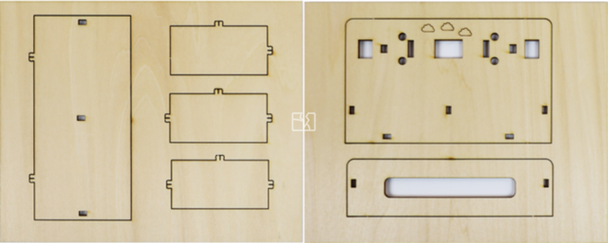  |
| 11 | Screwdriver | 1 | 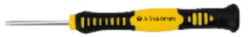 |
