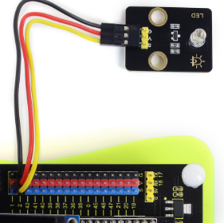
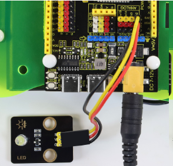
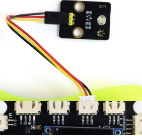
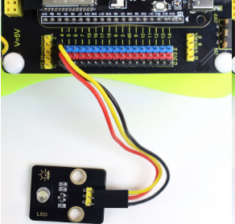

# 2. Product Interface

## 2.1 Sensor Expansion Pack Interface (KT0378)

By default, all 3-pin modules in this tutorial use **GPIO 2**, and 4-pin modules use **GPIO 8 and GPIO 9** (used as regular digital pins for now). Since several modules share the same pins, they **cannot be used at the same time** — plug them in one at a time or change the pins yourself.

> Wiring note: On the **mini / pro / rover** boards, wire per the default **GPIO 2**; on the **cam** camera version, use **GPIO 4** instead (GPIO 2 is occupied by the microphone) and change all IO2 to IO4 in the code.

**Interface quick reference**

| Sensor / Module | GPIO Pin | Pin Function |
| --- | --- | --- |
| White LED Module | GPIO 2 | Digital output |
| 6812 RGB Module | GPIO 2 | Single-bus data |
| Watering Pump | GPIO 8, GPIO 9 | IN1, IN2 |
| Photoresistor Sensor | GPIO 2 | ADC analog input |
| Sound Sensor | GPIO 2 | ADC analog input |
| Water Drop Sensor | GPIO 2 | ADC analog input |
| LM35 Temperature Sensor | GPIO 2 | ADC analog input |
| MQ-2LPG Gas Sensor | GPIO 9 | ADC analog input |
| 9G Servo | GPIO 2（Rover mainboard:  GPIO14） | PWM output |
| HC-SR04 Ultrasonic | GPIO 8, GPIO 9 | TRIG, ECHO |
| Stepper Motor Module | GPIO 8, GPIO 9, GPIO 13（Rover mainboard: GPIO48）, GPIO 14 | IN1, IN2, IN3, IN4 |
| Buzzer Module | GPIO 2 | Digital output |
| Soil Moisture Sensor | GPIO 2 | ADC analog input |

### Wiring Examples

**Basic version**

---

**Advanced version**

---

**Mobile version**

> Some module interfaces on the mobile version main board use XH-2.54 terminals. The kit includes dedicated XH-2.54 to jumper wire adapters (4P and 3P), making it easy to connect the ultrasonic sensor, photoresistor, and other modules.

---

**Camera version**

> Camera version note: on this version GPIO 2 is occupied by the microphone, so connect the 3-pin sensor signal wire to **GPIO 4** instead, and change all IO2 to IO4 in the code. Modified complete code is provided — just wire it as shown above.

**Feel free to extend**: the pins above are the tutorial default configuration for beginners. Once you master the basics, you are welcome to change the GPIO pins for your own expansion — the jumper wires in the kit can connect to any port on the development board, enabling more module combinations.

## 2.2 Wooden Model Expansion Pack Interface (KT0379)

The table below summarizes the hardware connections of each project from the model project tutorial (Chapter 6):

| Model Project | Module | Pin | Note |
| --- | --- | --- | --- |
| Rotating Color Light | WS2812 RGB LED Strip | IO10(Rover mainboard:  IO2) | 4 LEDs |
| Rotating Color Light | Active Buzzer | IO2 | Plays notification tones and music |
| Rotating Color Light | Stepper Motor IN1 | IO8 | 28BYJ-48 driver |
| Rotating Color Light | Stepper Motor IN2 | IO9 | 28BYJ-48 driver |
| Rotating Color Light | Stepper Motor IN3 | IO13(Rover mainboard:  GPIO48) | 28BYJ-48 driver |
| Rotating Color Light | Stepper Motor IN4 | IO14 | 28BYJ-48 driver |
| Environment Monitoring | Thermistor (temperature) | IO2(CAM mainboard: IO15) | Analog input |
| Environment Monitoring | Photoresistor (light) | IO3(CAM mainboard: IO16) | Analog input |
| Environment Monitoring | Gas Sensor (air) | IO9 | Analog input |
| Automatic Watering | Pump Motor IN1 | IO8 | Motor driver |
| Automatic Watering | Pump Motor IN2 | IO9 | Motor driver |
| Automatic Watering | Soil Moisture Sensor | IO3 | Analog input |
| Smart Trash Bin | Servo | IO14 | Open 120°, close 10° |
| Smart Trash Bin | Ultrasonic Trig | IO8 | Trigger |
| Smart Trash Bin | Ultrasonic Echo | IO9 | Echo |

> Note: each model project is an independent example. If you build different projects on the same main control board one after another, rewire according to the wiring table of the corresponding chapter. 
