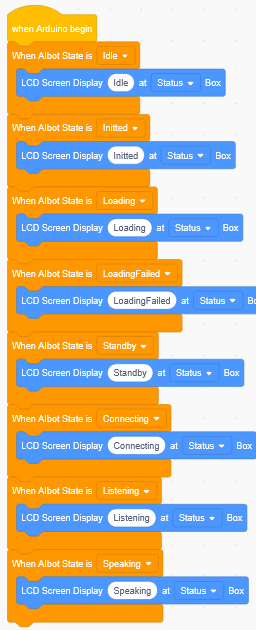
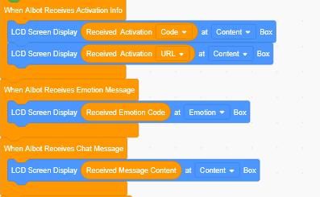

# 3. Basic Framework

The following code is the common basic framework shared by all module projects. It exists in every project code and is used to initialize the hardware, connect to the network, register voice services, etc. To keep the tutorial concise, this part will not be re-explained in the following projects.

## 1. Hardware Initialization

On startup, the program completes the following initialization steps in order:

- **I2S microphone initialization**: configure the microphone clock and data pins for capturing the user's voice
- **I2S speaker initialization**: configure the speaker clock and data pins for playing the AI's voice replies
- **LCD initialization**: configure the screen's SPI pins (backlight, MOSI, CLK, DC, RST, CS) for displaying device status and conversation content

## 2. WiFi Connection and Configuration

After startup, the device automatically tries to connect to the saved WiFi network:
- **Connection successful**: the device announces "网络已连接" (Network connected) and enters standby mode
- **Connection failed**: the device enters AP provisioning mode. A hotspot named `KEYES-AI-XXXX` can be found on your phone. After connecting to the hotspot, the **KEYES WIFI configuration** page usually pops up automatically. If it does not, open a browser manually and visit http://192.168.4.1

For details, refer to the main board process at http://192.168.4.1

## 3. Registering MCP Services

Each project needs to register the MCP tool for the current module with the Xiaozhi AI server. The registration includes:

- **Service name**: the function name of the current module
- **Description**: what the function does
- **Parameters**: the parameter names and types required by the function

After registration, users can call these tools through voice commands to achieve voice control.

## 4. Starting the AI Engine

After configuring the Xiaozhi AI backend address, the program starts the engine and sets the language and volume. The device enters standby mode and waits for the user to say the wake word "hello Xiaozhi" .

## 5. LCD Status Display

During operation, the LCD displays the current status in real time:

| Device Status | LCD Display |
| --- | --- |
| Connecting to WiFi | 连接中 (Connecting) |
| WiFi connected | 网络已连接 (Network connected) |
| Connecting to server | 加载中 (Loading) |
| Server connection failed | 加载失败 (Load failed) |
| Standby (waiting for wake word) | 待命 (Standby) |
| Awake / recording | 聆听中 (Listening) |
| AI replying / playing audio | 说话中 (Speaking) |

## 6. Common Event Callbacks

| Trigger Event | LCD Display |
| --- | --- |
| Activation code received | Content box shows the 6-digit code |
| Expression message received | Expression box shows the expression code |
| Chat message received | Content box shows the message content |
