# 5. Sensor Expansion Projects

## Project 1: White LED Module

### 1. Description

The white LED module is one of the most basic output components in electronics. An LED (light-emitting diode) is a semiconductor device that converts electrical energy into light energy. It has the advantages of low power consumption, long life, and fast response, and is widely used in indicator lights, display backlights, lighting, and other fields.

This module uses a high-brightness white LED. When the signal pin (S) is at a high level, the LED lights up; at a low level, it turns off. You can control the LED with the voice commands "打开LED" (turn on the LED) and "关闭LED" (turn off the LED), learning the basic concepts of digital output and voice control.

### 2. Specifications

| Parameter | Specification |
| --- | --- |
| Operating Voltage | DC 3V3 / 5V |
| Interface Type | 2.54mm anti-reverse header |
| Power Consumption | About 20mA (at 5V) |

### 3. Component List

| Component | Qty |
| --- | --- |
| Xiaozhi AI Chat Robot main control board | 1 |
| White LED module | 1 |
| 3-pin jumper wire | 1 |

### 4. Wiring Diagram

> Wiring note: For the signal lines marked **GPIO 2** in the table, connect them to **GPIO 2** on the **mini / pro / rover** boards. On the **cam** camera version, use **GPIO 4** instead (GPIO 2 is occupied by the microphone) and change all IO2 to IO4 in the code.

| **White LED Module** | **Development Board** |
| --- | --- |
| G | GND |
| V | 3V3 / 5V |
| S | **GPIO 2** |

### 5. Block Code

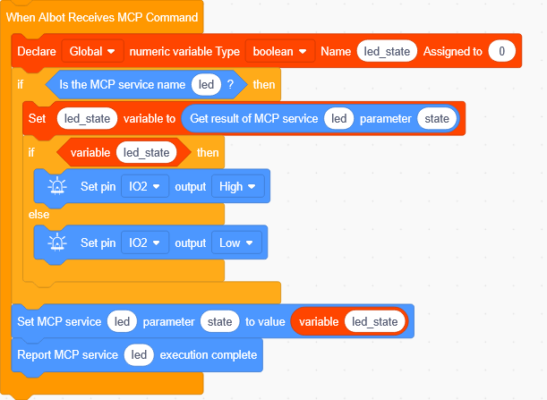

### 6. Code Explanation

The core of this project is to control the LED on and off through GPIO digital output.

① Register an MCP service: the program registers a tool with the Xiaozhi AI server.

② Set the control parameter: the tool receives a boolean parameter, state.

When state is `true`, it means "turn on"; when `false`, it means "turn off".

③ Execute the control: when the server calls this tool, the program takes the state value from the parameter.

④ Output the control signal: according to the state value, the program outputs a high or low level on GPIO 2, turning the LED on or off.

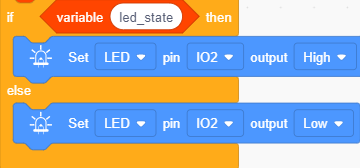

⑤ Return the execution result: the program returns a successful result to the server.

### 7. Test Results

> Note: Press the BOOT button on the board once before testing — the display shows “聆听中” (Listening) and the device enters conversation mode, ready for voice commands.

Talk to Xiaozhi:
- Say "Xiaozhi, turn on the LED" → The LED lights up
- Say "Xiaozhi, turn off the LED" → The LED turns off

The white LED module can be turned on and off by voice command, with a fast response and accurate state switching.

### 8. Extended Practice

Try modifying the code so the LED automatically turns off 5 seconds after lighting up, creating a "timed light off" function.

## Project 2: 6812 RGB Module

### 1. Description

The 6812 RGB module is a full-color LED module integrated with the SK6812 smart control chip. Unlike traditional RGB modules that need multiple pins to control red, green, and blue separately, the 6812 RGB module uses single-bus communication — only one signal wire is needed to control each LED's color and brightness independently. Each LED integrates a control circuit and light-emitting chip, supports 256-level brightness adjustment, and can display up to 16777216 colors in combination.

This module is suitable for various colorful lighting effects, such as ambient lights, flowing lights, and breathing lights. You can switch between different lighting effects by voice command, learning the basic principles of single-bus communication and PWM control.

### 2. Specifications

| Parameter | Specification |
| --- | --- |
| LED Type | SMD 5050 RGB |
| Operating Voltage | DC 3V3 / 5V |
| Maximum Power | 1W |
| IC Model | 4pcs / WS2811 |
| Gray Level | 256 levels |
| Light Angle | 180° |
| Operating Temperature | -10℃ to +50℃ |
| Power Consumption | About 20mA (at 5V) |

### 3. Component List

| Component | Qty |
| --- | --- |
| Xiaozhi AI Chat Robot main control board | 1 |
| 6812 RGB module | 1 |
| 3-pin jumper wire | 1 |

### 4. Wiring Diagram

> Wiring note: For the signal lines marked **GPIO 2** in the table, connect them to **GPIO 2** on the **mini / pro / rover** boards. On the **cam** camera version, use **GPIO 4** instead (GPIO 2 is occupied by the microphone) and change all IO2 to IO4 in the code.

| **6812 RGB Module** | **Development Board** |
| --- | --- |
| G | GND |
| V | 3V3 / 5V |
| S | **GPIO 2** |

### 5. Block Code

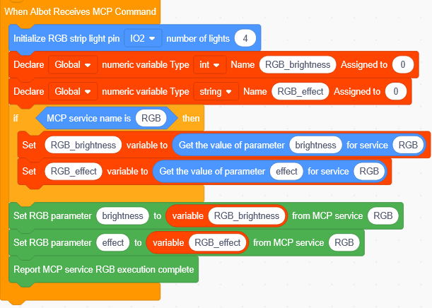

### 6. Code Explanation

The core of this project is to control the RGB light to display different lighting effects through single-bus communication.

① Initialize the RGB light: set the control pin and the number of LEDs.

② Create variables: create two global variables to store the data sent by voice commands.

brightness stores the brightness (0~255), and effect_name stores the effect name (such as "rainbow").

③ Register an MCP service: register a tool named RGB so the voice assistant can recognize this function.

The service name is RGB, with parameters brightness (number) and effect (string). After registration, the user's voice commands can be recognized by the server and forwarded to the device.

④ Receive MCP commands: after the user gives a voice command, the server calls the rgb tool and sends back the brightness and effect parameters.

Check whether the service name is RGB; if so, take out brightness and effect and store them in variables.

⑤ Execute the lighting effect: pass the variable values to the RGB light and execute the corresponding effect.

Check the value of effect_name and execute the corresponding effect branch.

⑥ Report the execution result: after the lighting effect is executed, report "execution complete" to the server.

### 7. Test Results

> Note: Press the BOOT button on the board once before testing — the display shows “聆听中” (Listening) and the device enters conversation mode, ready for voice commands.

Talk to Xiaozhi:
- Say "Xiaozhi, rainbow mode" → Rainbow effect
- Say "Xiaozhi, breathing light" → Breathing effect
- Say "Xiaozhi, flashing mode" → Flashing effect
- Say "Xiaozhi, flowing light" → Flowing effect
- Say "Xiaozhi, turn off the light" → RGB off

The 6812 RGB module switches between different animation effects according to voice commands, with smooth color transitions and fluid animation.

### 8. Extended Practice

Try adding new lighting effects to the code, such as "two-color gradient" or "random flashing".

## Project 3: Water Pump Drive Module + Watering Pump

### 1. Description

The watering pump is a silent mini submersible pump (model JT-DC3W-3) with an IP68 waterproof rating, so it can be placed directly in water. Combined with a soil moisture sensor, it can form a smart plant watering system. Once powered on, the pump draws water from a low point to a high point to water plants automatically.

This module uses two GPIOs to control the pump's on/off and speed: one pin controls the on/off state, and the other outputs a PWM signal for speed control. You can start and stop the pump via voice command, learning the basic principle of PWM speed control.

### 2. Specifications

| Parameter | Specification |
| --- | --- |
| Product Type | Watering pump (silent mini submersible pump) |
| Model | JT-DC3W-3 |
| Current | 0.12A |
| Working Voltage | DC 3V-5V |
| Power | 0.36W |
| Max Water Head | 0.35M |
| Max Flow Rate | 80 L/H |
| Starting Voltage | 1V |
| Waterproof Grade | IP68 |

### 3. Component List

| Component | Qty |
| --- | --- |
| Xiaozhi AI Chat Robot main control board | 1 |
| Watering pump | 1 |
| Water pump drive module | 1 |
| 4-pin jumper wire | 1 |

### 4. Wiring Diagram

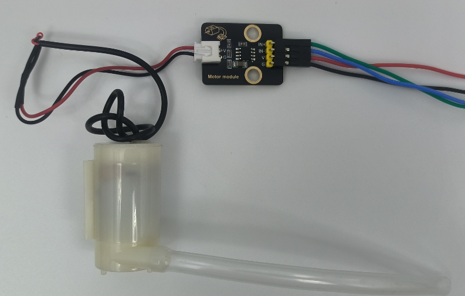

| **Water Pump Drive Module** | **Development Board** |
| --- | --- |
| IN1 | **GPIO 8** |
| IN2 | **GPIO 9** |
| V | 3V3 / 5V |
| G | GND |

### 5. Block Code

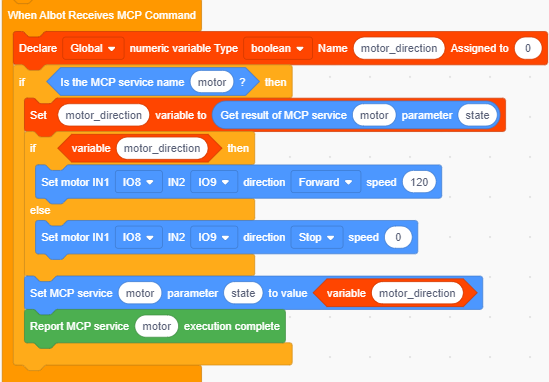

### 6. Code Explanation

The core of this project is to control the pump's on/off through GPIO.

① Register an MCP service: the program registers a tool with the server.

② Set the control parameter: the tool receives a boolean parameter, state, which turns the pump on and off.

③ Create a variable: create a variable to store the pump state value.

④ Check the switch: when the variable is true, turn the pump on; when it is false, turn it off.

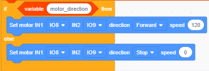

> **Note**: this kit is powered by 4 or 6 AA batteries, which cannot drive a high-power pump. It is for demonstration only. If you need more power, you can replace the batteries with high-discharge-rate batteries (make sure the voltage is the same).

### 7. Test Results

> Note: Press the BOOT button on the board once before testing — the display shows “聆听中” (Listening) and the device enters conversation mode, ready for voice commands.

Talk to Xiaozhi:
- Say "Xiaozhi, turn on the pump" → Pump starts
- Say "Xiaozhi, turn off the pump" → Pump stops

The watering pump can start and stop according to voice commands; the higher the PWM value, the faster the speed.

### 8. Extended Practice

Try adding PWM speed control to the code and adjusting the pump speed via voice command.

## Project 4: Photoresistor Sensor

### 1. Description

The photoresistor sensor is a sensor that works on the photoconductive effect of a semiconductor photosensitive element. Its core component is a photoresistor — a special resistor whose resistance changes with the intensity of incident light. The stronger the light is, the lower the resistance of the photoresistor and the higher the output voltage will be; the dimmer the light is, the higher the resistance and the lower the output voltage will be.

This module combines the photoresistor with a fixed resistor to form a voltage divider circuit, converting the light intensity change into a voltage signal output (analog). By reading this voltage signal through the ESP32's ADC pin, the ambient light intensity can be quantified. You can query the current light intensity by voice command, learning the basic principles of analog signal acquisition and ADC conversion.

### 2. Specifications

| Parameter | Specification |
| --- | --- |
| Sensor Type | Photoresistor |
| Operating Voltage | 3V3 / 5V |
| Photoresistive Range | 2-20KΩ (affected by light intensity) |
| Power Consumption | About 20mA (at 5V) |

### 3. Component List

| Component | Qty |
| --- | --- |
| Xiaozhi AI Chat Robot main control board | 1 |
| Photoresistor sensor | 1 |
| 3-pin jumper wire | 1 |

### 4. Wiring Diagram

> Wiring note: For the signal lines marked **GPIO 2** in the table, connect them to **GPIO 2** on the **mini / pro / rover** boards. On the **cam** camera version, use **GPIO 4** instead (GPIO 2 is occupied by the microphone) and change all IO2 to IO4 in the code.

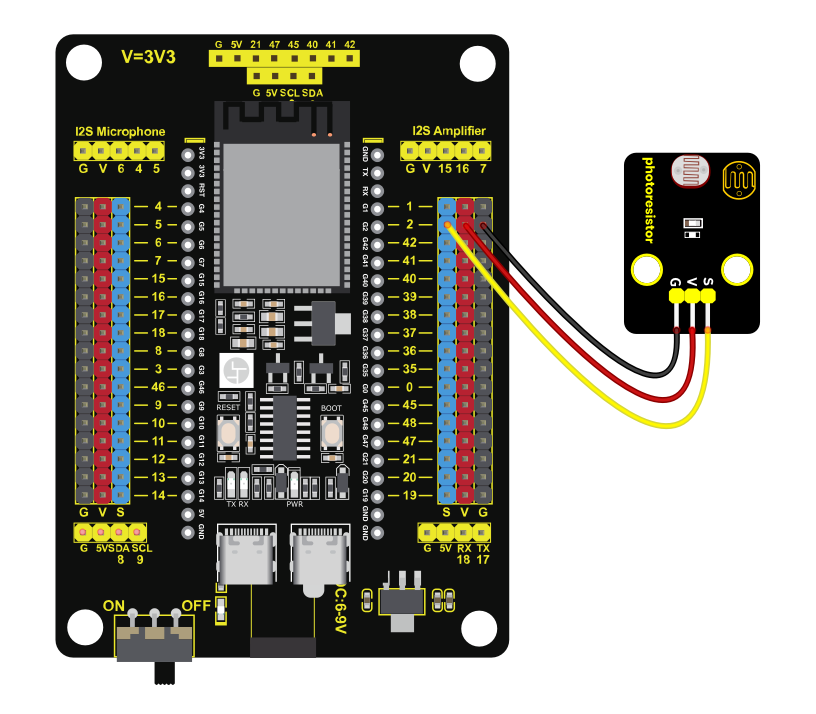

| **Photoresistor Sensor** | **Development Board** |
| --- | --- |
| G | GND |
| V | 3V3 / 5V |
| S | **GPIO 2** (ADC pin) |

### 5. Block Code

### 6. Code Explanation

The core of this project is to read the analog voltage of the photoresistor sensor through ADC to obtain the ambient light intensity.

① Register an MCP service: the program registers a tool with the server.

This tool has no input parameters and returns the current light intensity value (0~4095).

② Create a variable: create a variable to store the read light value.

③ Read the analog value: when the server calls this tool, the program reads the analog value of GPIO 2 through ADC.

The stronger the light is, the larger the value will be; the dimmer the light is, the smaller the value will be.

④ Return the result: after reading, return the value to the server for broadcasting.

### 7. Test Results

> Note: Press the BOOT button on the board once before testing — the display shows “聆听中” (Listening) and the device enters conversation mode, ready for voice commands.

Talk to Xiaozhi:
- Say "Xiaozhi, read the light intensity" → Broadcasts the current light intensity value

Cover the photoresistor sensor with your hand or change the ambient light intensity, and different light values will be broadcast when you query by voice.

### 8. Extended Practice

Combine it with the white LED module to make a "smart sensing light" — the LED automatically lights up when the ambient light is below a set threshold.

## Project 5: Sound Sensor

### 1. Description

The sound sensor is an acoustic sensor that converts sound signals into electrical signals. Its core component is a microphone (MIC), which picks up ambient sound and converts it into a weak voltage signal. After processing by the internal amplifier circuit, it outputs an analog voltage signal that can be read by a microcontroller. The louder the sound, the higher the output voltage and the larger the ADC reading; the quieter the sound, the lower the output voltage.

This module is suitable for interactive scenarios such as sound-activated switches, volume detection, and voice triggering. You can query the current sound intensity by voice command, learning the basic principles of sound signal acquisition and amplifier circuits.

### 2. Specifications

| Parameter | Specification |
| --- | --- |
| Sensor Type | Sound sensor |
| Operating Voltage | DC 3V3 / 5V |
| Detection Frequency | 7-20KHz |
| Power Consumption | About 20mA (at 5V) |

### 3. Component List

| Component | Qty |
| --- | --- |
| Xiaozhi AI Chat Robot main control board | 1 |
| Sound sensor | 1 |
| 3-pin jumper wire | 1 |

### 4. Wiring Diagram

> Wiring note: For the signal lines marked **GPIO 2** in the table, connect them to **GPIO 2** on the **mini / pro / rover** boards. On the **cam** camera version, use **GPIO 4** instead (GPIO 2 is occupied by the microphone) and change all IO2 to IO4 in the code.

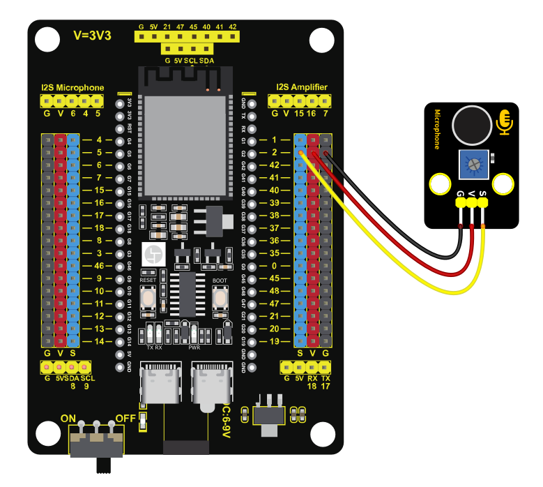

| **Sound Sensor** | **Development Board** |
| --- | --- |
| G | GND |
| V | 3V3 / 5V |
| S | **GPIO 2** (ADC pin) |

### 5. Block Code

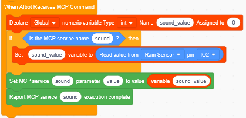

### 6. Code Explanation

The core of this project is to read the analog voltage of the sound sensor through ADC to obtain the sound intensity.

① Register an MCP service: the program registers a tool with the server.

This tool has no input parameters and returns the current sound intensity value (0 ~ 4095).

② Create a variable: create a variable to store the read sound value.

③ Read the analog value: when the server calls this tool, the program reads the analog value of GPIO 2 through ADC.

The value is low when it is quiet (about 100 ~ 300), and rises significantly when you speak or clap (500 ~ 2000+).

④ Return the result: after reading, return the value to the server for broadcasting.

### 7. Test Results

> Note: Press the BOOT button on the board once before testing — the display shows “聆听中” (Listening) and the device enters conversation mode, ready for voice commands.

Talk to Xiaozhi:
- Say "Xiaozhi, read the sound intensity" → Broadcasts the current sound intensity value

Speak or clap near the sound sensor, and different sound intensity values will be broadcast when you query by voice.

### 8. Extended Practice

Combine it with the white LED module to make a "sound-activated light" — the LED flashes or lights up when sound is detected.

## Project 6: Water Drop Sensor

### 1. Description

The water drop sensor is a sensor that detects humidity or moisture by measuring the resistance change between PCB traces. Its detection area consists of two interleaved copper foil traces. When the sensor surface is dry, the resistance between the two traces is very high and the output voltage is close to the supply voltage. When water drops land on the detection area, the water conducts across the gap between the two traces, lowering the resistance and thus lowering the output voltage. More water means lower resistance and lower output voltage.

This module is suitable for scenarios such as rain detection, leak monitoring, and overflow alarms. You can query whether water is detected by voice command, learning the basic principles of resistive sensors and voltage divider circuits.

### 2. Specifications

| Parameter | Specification |
| --- | --- |
| Sensor Type | Water drop sensor |
| Operating Voltage | DC 3V3 / 5V |
| Power Consumption | About 20mA (at 5V) |

### 3. Component List

| Component | Qty |
| --- | --- |
| Xiaozhi AI Chat Robot main control board | 1 |
| Water drop sensor | 1 |
| 3-pin jumper wire | 1 |

### 4. Wiring Diagram

> Wiring note: For the signal lines marked **GPIO 2** in the table, connect them to **GPIO 2** on the **mini / pro / rover** boards. On the **cam** camera version, use **GPIO 4** instead (GPIO 2 is occupied by the microphone) and change all IO2 to IO4 in the code.

| **Water Drop Sensor** | **Development Board** |
| --- | --- |
| G | GND |
| V | 3V3 / 5V |
| S | **GPIO 2** (ADC pin) |

### 5. Block Code

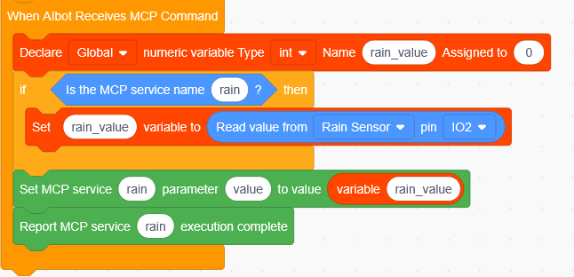

### 6. Code Explanation

The core of this project is to read the analog voltage of the water drop sensor through ADC to detect whether there is water.

① Register an MCP service: the program registers a tool with the server.

This tool has no input parameters and returns the current humidity detection value (0 ~ 4095).

② Create a variable: create a variable to store the read humidity value.

③ Read the analog value: when the server calls this tool, the program reads the analog value of GPIO 2 through ADC.

The value is high when the sensor is dry (3000 ~ 4095), drops significantly when there are water drops (500 ~ 2000), and is close to 0 when fully submerged. This is because water conducts across the traces, lowering the output voltage.

④ Return the result: after reading, return the value to the server for broadcasting.

### 7. Test Results

> Note: Press the BOOT button on the board once before testing — the display shows “聆听中” (Listening) and the device enters conversation mode, ready for voice commands.

Talk to Xiaozhi:
- Say "Xiaozhi, check if there is water" → Broadcasts the current water drop sensor status

Use a dropper to put a drop of water on the detection area of the water drop sensor, and a clearly changed value will be broadcast when you query by voice.

### 8. Extended Practice

Combine it with the voice broadcast function to make a "rain alarm" — actively triggers a voice prompt when water is detected.

## Project 7: LM35 Temperature Sensor

### 1. Description

The LM35 temperature sensor is a high-precision linear temperature sensor whose output voltage is proportional to the temperature in Celsius, with a conversion factor of 10mV/℃. This means that when the temperature rises by 1℃, the output voltage increases by 10mV. For example, at 25℃ the output voltage is 250mV, and at 100℃ it is 1000mV. The LM35 has the advantages of high measurement accuracy, good linearity, and low cost, with a measurement range covering -55℃ to +150℃.

This module is widely used in ambient temperature monitoring, smart temperature control systems, electronic thermometers, and other fields. You can query the current ambient temperature by voice command, learning the data acquisition and value conversion methods of analog sensors.

### 2. Specifications

| Parameter | Specification |
| --- | --- |
| Sensor Type | LM35 temperature sensor |
| Operating Voltage | DC 3V3 / 5V |
| Temperature Range | -55℃ to +150℃ |
| Output Voltage | 10mV/℃ |
| Power Consumption | About 60µA (at 5V) |

### 3. Component List

| Component | Qty |
| --- | --- |
| Xiaozhi AI Chat Robot main control board | 1 |
| LM35 temperature sensor | 1 |
| 3-pin jumper wire | 1 |

### 4. Wiring Diagram

> Wiring note: For the signal lines marked **GPIO 2** in the table, connect them to **GPIO 2** on the **mini / pro / rover** boards. On the **cam** camera version, use **GPIO 4** instead (GPIO 2 is occupied by the microphone) and change all IO2 to IO4 in the code.

| **LM35 Temperature Sensor** | **Development Board** |
| --- | --- |
| G | GND |
| V | 3V3 / 5V |
| S | **GPIO 2** (ADC pin) |

### 5. Block Code

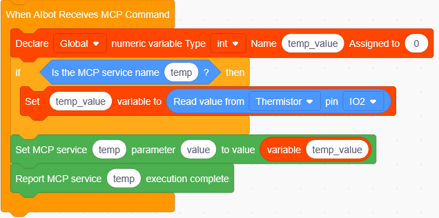

### 6. Code Explanation

The core of this project is to read the analog voltage of the LM35 temperature sensor through ADC and convert it into the actual temperature with a formula.

① Register an MCP service: the program registers a tool with the server.

This tool has no input parameters and returns the current temperature value (an integer magnified 10 times, e.g., 253 means 25.3℃).

② Create a variable: create a variable to store the raw ADC value.

③ Store the temperature result: create a variable to store the converted temperature value.

④ Read the analog value: when the server calls this tool, the program reads the analog value of GPIO 2 through ADC.

⑤ Convert the temperature: convert the ADC value into temperature with the formula Temperature = ADC value × 3300 / 40950.

For example, when the ADC value is 310, Temperature = 310 × 3300 / 40950 ≈ 25℃, which matches the actual room temperature.

⑥ Return the result: return the temperature value to the server for broadcasting.

### 7. Test Results

> Note: Press the BOOT button on the board once before testing — the display shows “聆听中” (Listening) and the device enters conversation mode, ready for voice commands.

Talk to Xiaozhi:
- Say "Xiaozhi, what is the current temperature" → Broadcasts the current temperature value

At room temperature, the room temperature value is broadcast (about 20~30℃). Pinch the LM35 temperature sensor with your hand and the value gradually rises.

### 8. Extended Practice

Display the current temperature value on the LCD screen in real time and update it automatically at intervals.

## Project 8: MQ-2 Gas Sensor

### 1. Description

The Keyes MQ-2 gas sensor is a semiconductor combustible gas detection sensor with high sensitivity to methane, LPG, coal gas, and other combustible gases. Its working principle is based on the characteristic that the resistance of tin dioxide (SnO2) semiconductor material changes when it contacts combustible gas. When combustible gas is present in the air, the conductivity of the sensor increases with the gas concentration, and this change can be converted into a voltage signal output through a voltage divider circuit.

The MQ-2 has the advantages of fast response, long life, and low cost, and is widely used in gas leak alarms, gas detectors, smart home security systems, and other scenarios. Before use, preheat for 1~2 minutes so that the heating wire inside the sensor reaches a stable working temperature. You can query the current gas concentration by voice command, learning the basic principles of semiconductor gas sensors.

### 2. Specifications

| Parameter | Specification |
|------|------|
| Sensor Type | MQ-2 gas sensor |
| Operating Voltage | DC 3V3 / 5V |
| Detected Gases | Methane (CH4), LPG, coal gas, etc. |
| Power Consumption | About 150mA (at 5V, including heating wire) |

### 3. Component List

| Component | Qty |
|------|------|
| Xiaozhi AI Chat Robot main control board | 1 |
| MQ-2 gas sensor | 1 |
| 4-pin jumper wire | 1 |

### 4. Wiring Diagram

> Wiring note: For the signal lines marked **GPIO 2** in the table, connect them to **GPIO 2** on the **mini / pro / rover** boards. On the **cam** camera version, use **GPIO 4** instead (GPIO 2 is occupied by the microphone) and change all IO2 to IO4 in the code.

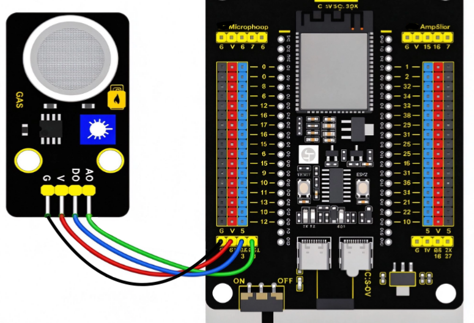

| **MQ-2 Gas Sensor** | **Development Board** |
| --- | --- |
| G | GND |
| V | 3V3 / 5V |
| S | **GPIO 9** (ADC pin) |

> The MQ-2 gas sensor readings are stable only after 1~2 minutes of preheating.

### 5. Block Code

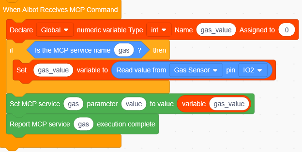

### 6. Code Explanation

The core of this project is to read the analog voltage of the MQ-2 gas sensor through ADC to determine the combustible gas concentration.

① Register an MCP service: the program registers a tool with the server.

This tool has no input parameters and returns the current gas concentration value (0~4095).

② Create a variable: create a variable to store the read gas concentration value.

③ Read the analog value: when the server calls this tool, the program reads the analog value of GPIO 2 through ADC.

Under normal conditions, the value is relatively stable (about 100 ~ 200). When combustible gas is detected, the value rises quickly (up to 2000 ~ 3000+); the higher the concentration, the larger the value. This is because the semiconductor material's resistance decreases when it contacts gas, raising the voltage divider output.

④ Return the result: after reading, return the value to the server for broadcasting.

### 7. Test Results

> Note: Press the BOOT button on the board once before testing — the display shows “聆听中” (Listening) and the device enters conversation mode, ready for voice commands.

Talk to Xiaozhi:
- Say "Xiaozhi, check for gas leak" → Broadcasts the current gas concentration value

Hold lighter gas near the MQ-2 gas sensor (without igniting), and a clearly elevated value will be broadcast when you query by voice.

### 8. Extended Practice

Set an alarm threshold; when the detected value exceeds the threshold, trigger the voice prompt "检测到燃气泄漏，请注意安全！" (Gas leak detected, please pay attention to safety!).

## Project 9: 9G Servo

### 1. Description

The 9G servo is a micro servo motor that precisely controls the rotation angle of its output shaft through PWM (pulse width modulation) signals. Inside the servo are a DC motor, a reduction gear set, a position feedback potentiometer, and a control circuit, forming a closed-loop control system. The control circuit receives a PWM signal with a pulse width (usually 0.5ms ~ 2.5ms), compares it with the current position fed back by the potentiometer, and drives the motor to rotate to the target angle and hold there. The angle range is usually 0° ~ 180°.

The 9G servo is small, lightweight, and has moderate torque. It is widely used in robot joints, camera gimbals, robotic arms, toy models, and other scenarios. You can control the servo to rotate to a specified angle by voice command, learning the basic principles of PWM signals and servo control.

### 2. Specifications

| Parameter | Specification |
| --- | --- |
| Type | 9G micro servo |
| Operating Voltage | DC 3.3V ~ 6V |
| Angle Range | 0° ~ 180° |
| Torque | About 1.5~2.0 kg·cm (at 5V) |
| Control Signal | PWM (period 20ms, pulse width 0.5ms~2.5ms) |

### 3. Component List

| Component | Qty |
| --- | --- |
| Xiaozhi AI Chat Robot main control board | 1 |
| 9G servo | 1 |
| 3-pin jumper wire | 1 |

### 4. Wiring Diagram

> Wiring note: For the signal lines marked **GPIO 2** in the table, connect them to **GPIO 2** on the **mini / pro / rover** boards. On the **cam** camera version, use **GPIO 4** instead (GPIO 2 is occupied by the microphone) and change all IO2 to IO4 in the code.

| **9G Servo** | **Development Board** |
| --- | --- |
| Brown (GND) | GND |
| Red (VCC) | 3V3 / 5V |
| Orange (SIG) | **GPIO 2** (PWM pin) |

⚠️ Wiring note:
This tutorial demonstrates the Basic version (GPIO 2). If you are using the Mobile version (with the XH2.54 interface), connect the servo's own cable to GPIO 14. The code is already adapted for the Mobile version — no manual pin changes are needed, just use it directly.

### 5. Block Code

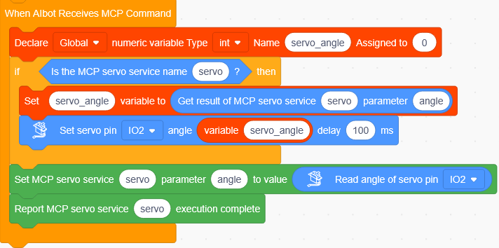

### 6. Code Explanation

The core of this project is to control the servo to rotate to a specified angle through PWM signals.

① Register an MCP service: the program registers a tool with the server.

This tool receives an angle parameter (angle 0~180).

② Create a variable: create a variable to store the angle value sent by the voice command.

③ Get the parameter: when the server calls this tool, the program takes the angle value from the parameter.

④ Output the PWM signal: after storing the angle value in the variable, control GPIO 2 to output the corresponding PWM signal, and the servo rotates to the specified angle.

⑤ Read the current angle: after execution, read the current servo angle.

### 7. Test Results

> Note: Press the BOOT button on the board once before testing — the display shows “聆听中” (Listening) and the device enters conversation mode, ready for voice commands.

Talk to Xiaozhi:
- Say "Xiaozhi, rotate the servo to 90 degrees" → The servo rotates to the specified angle
- Say "Xiaozhi, reset the servo" → The servo returns to 0 degrees

The 9G servo rotates accurately to the specified angle according to voice commands, with precise position control.

### 8. Extended Practice

Use the 9G servo to swing the HC-SR04 ultrasonic sensor back and forth, creating a "smart scanning radar" effect.

## Project 10: HC-SR04 Ultrasonic Sensor

### 1. Description

The HC-SR04 ultrasonic sensor is a common non-contact distance measurement sensor that measures the distance to an obstacle by emitting ultrasonic waves and receiving the echo. Its working principle is similar to bats' echolocation: the sensor first emits a burst of ultrasonic waves (40kHz) through the TRIG pin; the waves hit the obstacle and reflect back, and are received by the ECHO pin. By measuring the time difference between emission and reception, combined with the speed of sound in air (about 340m/s), the distance between the sensor and the obstacle can be calculated.

Ultrasonic distance measurement has the advantages of fast response, low cost, and immunity to ambient light. The measurement range is usually 3~400cm, and it is widely used in smart car obstacle avoidance, reversing radars, drone altitude holding, smart trash bins, and other scenarios. You can query the current obstacle distance by voice command, learning the principles of ultrasonic emission, reception, and ranging.

### 2. Specifications

| Parameter | Specification |
| --- | --- |
| Sensor Type | HC-SR04 ultrasonic sensor |
| Operating Voltage | DC 3.3V ~ 5V |
| Measurement Range | 3 ~ 400cm |
| Measurement Accuracy | About 3mm |
| Ultrasonic Frequency | 40kHz |

### 3. Component List

| Component | Qty |
| --- | --- |
| Xiaozhi AI Chat Robot main control board | 1 |
| HC-SR04 ultrasonic sensor | 1 |
| 4-pin jumper wire | 1 |

### 4. Wiring Diagram

| **HC-SR04 Ultrasonic Sensor** | **Development Board** |
| --- | --- |
| VCC | 3V3 / 5V |
| GND | GND |
| TRIG | **GPIO 8** |
| ECHO | **GPIO 9** |

### 5. Block Code

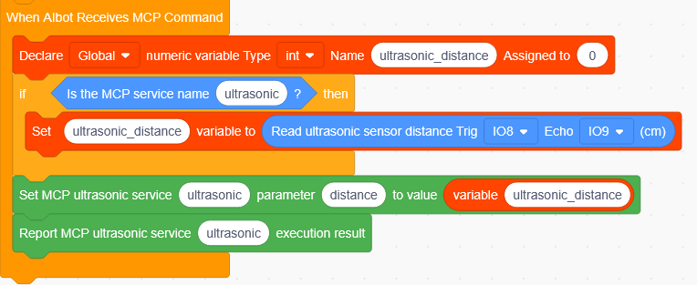

### 6. Code Explanation

The core of this project is to measure the distance to an obstacle with the ultrasonic sensor.

① Register an MCP service: the program registers a tool with the server.

This tool has no input parameters and returns the current distance value (0 ~ 400cm).

② Create a variable: create a variable to store the measured distance value.

③ Read the distance value: when the server calls this tool, the program reads the distance value of the ultrasonic sensor.

The principle of ultrasonic ranging is to emit sound waves and receive the echo, converting the time difference into distance.

④ Return the result: after reading, return the distance value to the server for broadcasting.

### 7. Test Results

> Note: Press the BOOT button on the board once before testing — the display shows “聆听中” (Listening) and the device enters conversation mode, ready for voice commands.

Talk to Xiaozhi:
- Say "Xiaozhi, measure the distance" → Broadcasts the current obstacle distance value

The serial port displays the distance between the HC-SR04 ultrasonic sensor and the obstacle in real time, and the current distance value is broadcast when you query by voice.

### 8. Extended Practice

Combine it with the 9G servo (Project 9): use the servo to swing the HC-SR04 ultrasonic sensor left and right to measure distances in multiple directions.

## Project 11: Stepper Motor Drive Module

### 1. Description

A stepper motor converts electrical pulse signals into angular displacement. Each pulse rotates the motor by a fixed angle (step angle). The number of pulses determines the rotation angle, and the pulse frequency determines the speed, so the rotation angle and number of turns can be precisely controlled. Stepper motors are widely used in 3D printers, robotic arms, gimbals, and other applications that require precise positioning.

This module uses a 28BYJ-48 stepper motor with a ULN2003 driver board, controlled through 4 GPIO pins (IN1~IN4). You can control forward rotation, reverse rotation, and stop by voice, learning the principles of stepper motor driving and pulse control.

### 2. Specifications

| Parameter | Specification |
| --- | --- |
| Motor Type | 28BYJ-48 stepper motor |
| Working Voltage | DC 5V |
| Step Angle | 5.625° (about 0.088° after 1:64 reduction) |
| Reduction Ratio | 1:64 |
| Driver Board | ULN2003 |

### 3. Components

| Component | Quantity |
| --- | --- |
| Xiaozhi AI chat robot main board | 1 |
| 28BYJ-48 stepper motor | 1 |
| ULN2003 driver board | 1 |
| 4P jumper wires | 1 |
| F-F DuPont wire | 2pcs |

### 4. Wiring Diagram

| **Stepper Motor Driver Board** | **Development Board** |
| --- | --- |
| IN1 | **GPIO 8** |
| IN2 | **GPIO 9** |
| IN3 | **GPIO 13** |
| IN4 | **GPIO 14** |
| VCC | 5V |
| GND | GND |

### 5. Block Code

### 6. Code Explanation

The core of this project is to output pulse signals in sequence through 4 GPIO pins to drive the stepper motor.

① Register an MCP service: the program registers a tool with the server.

This tool receives the direction parameter (forward / stop / reverse).

② Configure pins: set IO8, IO9, IO13, IO14 as outputs, corresponding to IN1~IN4 of the driver board.

③ Forward: output pulses in the order IN1→IN2→IN3→IN4 to rotate forward.

④ Reverse: output pulses in the reverse order to rotate in reverse.

⑤ Stop: stop outputting pulses and the motor stops.

> **Note**: drive the stepper motor with non-blocking `micros()` timing (see Section 6.1 Rotating Color Light in Chapter 6), not `delay()`, or the voice will freeze. After the 1:64 reduction, the 28BYJ-48 takes about 4096 steps per revolution.

### 7. Test Results

> Note: Press the BOOT button on the board once before testing — the display shows “聆听中” (Listening) and the device enters conversation mode, ready for voice commands.

Talk to Xiaozhi:
- Say "Xiaozhi, stepper motor forward 2048 steps" → The stepper motor rotates half a turn
- Say "Xiaozhi, stepper motor reverse 4096 steps" → The stepper motor rotates one full turn
- Say "Xiaozhi, motor stop" → The motor stops

### 8. Extended Practice

Try modifying the code so the motor rotates one full turn forward and then one full turn in reverse, creating a reciprocating swing.

## Project 12: Buzzer Module

### 1. Description

A buzzer is an electronic signaling device with an integrated structure. There are two types: active and passive. This module uses an active buzzer, which has a built-in oscillator — it sounds as soon as power is applied. Only one GPIO pin is needed: a high level makes it sound, a low level stops it. It is commonly used for notification tones, alarm sounds, and simple music.

You can control the buzzer on and off by voice, learning the basic method of driving an audio component with digital output.

### 2. Specifications

| Parameter | Specification |
| --- | --- |
| Buzzer Type | Active buzzer (with built-in oscillator) |
| Working Voltage | DC 3V3 / 5V |
| Interface | 2.54mm anti-reverse interface |

### 3. Components

| Component | Quantity |
| --- | --- |
| Xiaozhi AI chat robot main board | 1 |
| Buzzer module | 1 |
| 3P jumper wires | 1 |

### 4. Wiring Diagram

| **Buzzer Module** | **Development Board** |
| --- | --- |
| G | GND |
| V | 3V3 / 5V |
| S | **GPIO 2** |

> Wiring note: For the signal lines marked **GPIO 2** in the table, connect them to **GPIO 2** on the **mini / pro / rover** boards. On the **cam** camera version, use **GPIO 4** instead (GPIO 2 is occupied by the microphone) and change all IO2 to IO4 in the code.

### 5. Block Code

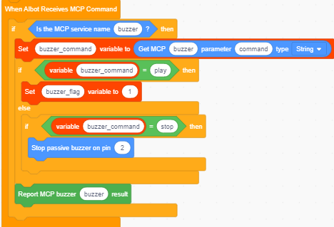

### 6. Code Explanation

The core of this project is to control the buzzer with digital output on a GPIO pin.

① Register an MCP service: the program registers a tool with the server.

② Set the control parameter: this tool receives a string parameter, command.

③ Output the control signal: when command is "play", play music; when command is "stop", the buzzer stops.

### 7. Test Results

> Note: Press the BOOT button on the board once before testing — the display shows “聆听中” (Listening) and the device enters conversation mode, ready for voice commands.

Talk to Xiaozhi:
- Say "Xiaozhi, set the buzzer to play music" → The buzzer plays music
- Say "Xiaozhi, turn off the buzzer" → The buzzer stops

### 8. Extended Practice

Try modifying the code so the buzzer stops automatically 3 seconds after sounding, creating a "timed reminder" function.

## Project 13: Soil Moisture Sensor

### 1. Description

The soil moisture sensor measures the water content of soil by detecting its conductivity: the wetter the soil, the higher the conductivity and the lower the output analog voltage; the drier the soil, the higher the output voltage. It is commonly used in automatic plant watering and agricultural planting scenarios.

This module outputs an analog signal. You can ask about the soil moisture level by voice, learning the basic methods of analog acquisition and data conversion.

### 2. Specifications

| Parameter | Specification |
| --- | --- |
| Sensor Type | Soil moisture sensor (probe + signal module) |
| Working Voltage | DC 3V3 / 5V |
| Output Signal | Analog (AO) |
| Interface | 2.54mm anti-reverse interface |

### 3. Components

| Component | Quantity |
| --- | --- |
| Xiaozhi AI chat robot main board | 1 |
| Soil moisture sensor (probe + module) | 1 |
| 4P jumper wires | 1 |

### 4. Wiring Diagram

| **Soil Moisture Sensor** | **Development Board** |
| --- | --- |
| G | GND |
| V | 3V3 / 5V |
| AO | **GPIO 2** (ADC pin) |

> Wiring note: For the signal lines marked **GPIO 2** in the table, connect them to **GPIO 2** on the **mini / pro / rover** boards. On the **cam** camera version, use **GPIO 4** instead (GPIO 2 is occupied by the microphone) and change all IO2 to IO4 in the code.

### 5. Block Code

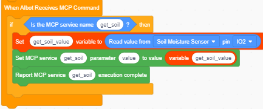

### 6. Code Explanation

The core of this project is to read the analog value of the soil moisture sensor through ADC and convert it to a moisture percentage.

① Register an MCP service: the program registers a tool with the server.

② Read the analog value: when the server calls this tool, the program reads the analog value of GPIO 2 through ADC.

### 7. Test Results

> Note: Press the BOOT button on the board once before testing — the display shows “聆听中” (Listening) and the device enters conversation mode, ready for voice commands.

Talk to Xiaozhi:
- Say "Xiaozhi, what is the soil moisture" → Broadcasts the current soil moisture

### 8. Extended Practice

Combine it with the watering pump (Project 3) to build a smart watering system that waters automatically when the soil is dry.

> **Extended learning**: after completing the 13 projects above, you can try combining multiple sensors — for example, use the 9G servo to swing the HC-SR04 ultrasonic sensor for scanning distance measurement, use the photoresistor sensor to control the brightness of the white LED module, and use the sound sensor to trigger voice interaction.
